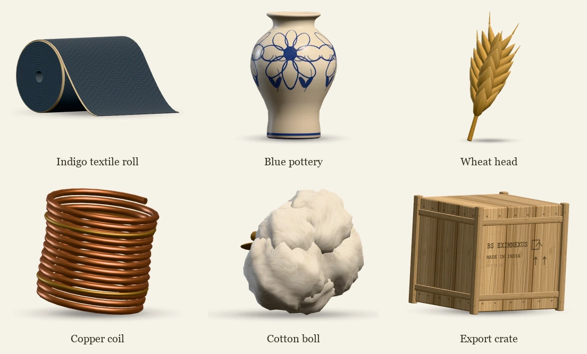

# Six category objects · materials and lighting plan

## Scope and acceptance

Keep the six existing exhibits, silhouettes, category order, yaw behavior, single gallery canvas, responsive layout and poster fallback. Improve the surface response at actual chapter and card sizes. Each material should remain recognizable during its turn and in the dock, and the first live frame should match the fallback's pose and lighting.

## Material direction

| Exhibit | Surface and detail | Light response and grounding |
| --- | --- | --- |
| Indigo roll | Matched warp and weft frequency across color and relief, directional herringbone, intact selvedge and finely spaced wound layers. | High roughness, quiet grazing light and a broad low shadow across the roll and loose tail. |
| Blue pottery | Warm clay and hand-painted cobalt, smoothed belly and lip, fine throwing rings and small glaze roughness variations. | Broad white glaze highlight, dark interior and tight contact at the narrow foot. |
| Wheat | Warm dry husks with fine longitudinal striations over the existing creased, vertex-colored heads. A shared map covers husks, stem and awns. | Matte golden tones with lit ridges and darker husk roots, plus a small soft shadow beneath the stem. |
| Copper | Continuous wire with closely spaced distinct turns, aligned cut face, lengthwise draw marks and rougher handling marks. | Colored conductor reflections under broad bright strips. Raise the roughness floor so reflections stay legible during rotation. |
| Cotton | Matte ivory lint with broad tufts, short fibers and darker roots where the lobes meet. Veined, drier sepals and stem. | Soft side light across the lint and gentle occlusion across the calyx. |
| Crate | Pale end-to-end softwood grain with growth rings, knots, nail heads and an in-place export stencil. Small edge bevels preserve the existing box shape. | Warm highlights on the battens, contact darkening at board joins and a broad rectangular footprint. |

## Rendering and delivery

1. Bake the deterministic color and relief maps with the existing Canvas tooling. Ship mipmapped, anisotropically filtered maps with sRGB for color and linear values for height and roughness. Pack shared height and roughness channels where both are needed. Put the asset URLs in the lazy gallery. Generate the small linear HDR studio locally and share it across the gallery's objects through Three.js PMREM.
2. Match a warm key, cooler rim and dark floor in the reflection rig and directional lighting. Use one soft footprint plane per exhibit with a concentrated contact core. Carry object-specific occlusion in textures and vertex colors. This keeps the cost at one main scene pass.
3. Preserve the existing framebuffer budgets, demand rendering, offscreen suspension, mobile motion window and still fallback. Let the existing poster-to-canvas handoff wait for loaded material maps and the first compiled frame. Rebuild the 750×600 and 375×300 transparent posters and refresh their asset versions.
4. Compare canonical captures and four yaw angles per object. Check the desktop journey and dock, phone-sized cards, poster-only reduced motion, and WebKit/Chromium. Record per-exhibit calls, triangles, texture estimates and timings with the measured browser and renderer. Aim for 60 FPS on a capable device and a stable adaptive fallback on constrained devices. Browser emulation and software rendering can verify behavior and measure relative cost, while device FPS requires hardware measurement.

## Research used

- Three.js filters environment radiance by material roughness through PMREM. The broad studio sources and roughness floors are sized for that filtering. [PMREMGenerator](https://threejs.org/docs/pages/PMREMGenerator.html)
- Three.js and Khronos distinguish sRGB reflectance textures from linear data textures. Three.js reads roughness from green and height from red, which allows a single mipmapped surface map where useful. [Three.js color management](https://threejs.org/manual/en/color-management.html) · [Khronos glTF metallic-roughness material](https://registry.khronos.org/glTF/specs/2.0/glTF-2.0.html#materials)
- Burley's production research motivates broad highlights for shaped surfaces and a separate grazing response for cloth. Use the extra sheen lobe on the weave where it can contribute at the final viewing size. [Physically Based Shading at Disney](https://www.disneyanimation.com/publications/physically-based-shading-at-disney/)
- Shadow maps draw casters again for each shadow light. An authored contact gradient with local occlusion gives a consistent floor cue at lower frame cost. The site's existing demand rendering and adaptive DPR handle idle and active costs. [Three.js shadows](https://threejs.org/manual/pages/shadows.html) · [React Three Fiber performance](https://r3f.docs.pmnd.rs/advanced/scaling-performance)

## Implemented and measured · 18 November 2026

The studio bake stores three rectangular light sources and a dark floor in a 512×256 PNG. The encoder scales linear radiance into the image’s range before sRGB encoding. At runtime the environment intensity restores that scale. The 7.5 kB lighting asset supports highlights above display white, and neutral tone mapping retains their roll-off. A warm key and cool rim supply direct illumination. The finished set of fifteen source maps totals 209,047 bytes, including the studio and contact shadow. Lower-resolution texture levels handle the smaller card and dock views.

| Exhibit | Draws before → after | Triangles before → after | Final estimated material textures |
| --- | ---: | ---: | ---: |
| Indigo roll | 3 → 3 | 2,810 → 2,810 | 1.08 MiB |
| Blue pottery | 3 → 3 | 2,738 → 5,522 | 2.83 MiB |
| Wheat | 2 → 2 | 2,914 → 2,914 | 0.25 MiB |
| Copper coil | 5 → 6 | 9,402 → 8,054 | 0.17 MiB |
| Cotton boll | 12 → 12 | 6,902 → 6,902 | 0.58 MiB |
| Export crate | 9 → 9 | 88 → 760 | 1.67 MiB |

Each capture includes the contact plane. The vase gained a curved profile, the crate gained beveled edges, and the continuous coil uses fewer triangles with two aligned cut faces. The material estimate counts unique maps per exhibit at RGBA8 plus mip levels, including its contact shadow. Shared maps appear in multiple rows. The environment, framebuffer and driver allocations are outside this estimate.

**Animation.** Chromium 153 on Windows used Intel Iris Xe graphics through Direct3D 11. On the production build, the last active chapter at 1440×900 produced 181 visible rotation updates in 3.004 seconds. At 390×844 and emulated 3× DPR, the crate card also produced 181 updates in 3.004 seconds. The respective median intervals were 16.7 and 16.6 ms, with a 17.3 ms 95th percentile in both runs. These are short, warm measurements of presented rotation updates on one GPU. Physical phones, cold mobile networks and sustained thermal performance remain unmeasured.

**Visual checks.** Four yaw angles per exhibit were inspected. Twelve transparent WebPs cover both fallback sizes. At 390×844 the measured average difference between the static poster and first live frame was 2.66 levels out of 255 for cloth and 2.49 for wheat, within the existing 3-level limit. The card renderer aligns its rasterized bounds to the fallback image, and high-density wheat cards can select the larger poster.

**Browser and build checks.** All 94 repository tests and the stage-boundary check passed. The production build passed with Vite’s size advisory for the shared Three.js chunk. Chromium passed desktop chapter and shelf interaction, phone rotation, freeze and resume, route return, lost-context recovery, and the reduced-motion, data-saving and WebGL-unavailable paths. The iPhone-sized WebKit run on Windows passed its gallery animation, scroll and navigation checks.

**Reproduction.** Run `node scripts/build-category-maps.mjs` to bake the surface and lighting assets, `npm test` for the structural checks, and `npm run build` for the production bundle. Serve the build, point `SITE_URL` at that preview, and run `node scripts/category-frame-timing.check.mjs` using the project's Playwright setup. Poster authoring uses the `posters` Vite mode and `scripts/build-posters.mjs` with the six named motifs.
